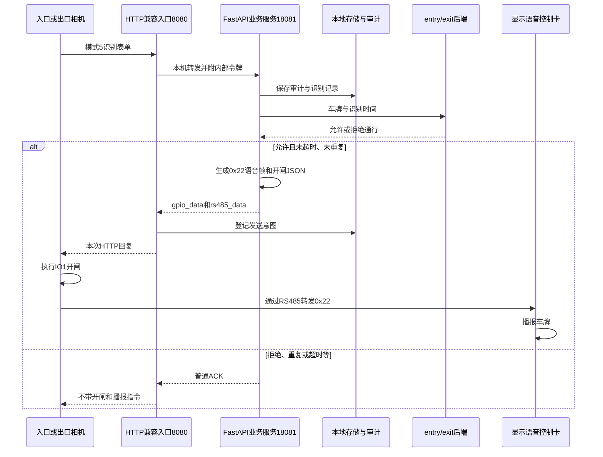

# 道闸语音播报功能：使用流程与代码详解

整理日期：2026-11-08。本文依据当前项目源码、配置，以及此前调试工具的实测记录编写。

项目目录：`D:\codex\2026-11-01\new-chat\outputs\gate_project`。

本文的目标是让你能够独立完成三件事：配置并启动语音功能；顺着代码理解一次车牌识别如何变成播报指令；根据日志判断问题发生在哪一步。

> 当前实现：后端允许通行后，在相机本次 HTTP 回复中同时携带开闸与播报指令。它不是等待闸杆完全抬起后再播报，也没有喇叭播放完成回执。

## 阅读路线

| 你的目标 | 建议阅读 |
| --- | --- |
| 先把功能用起来 | 第 1～4 节、第 10 节 |
| 理解协议和代码怎么写 | 第 5～9 节 |
| 没有声音或没有开闸时排查 | 第 10～11 节 |
| 自己运行代码样例、修改和验证 | 第 12～14 节 |

## 1. 谁在负责什么

系统中存在几个不同的角色，理解它们后就不会把服务器地址、串口地址和相机 ID 混在一起。

| 角色 | 负责的事情 | 是否直接合成或播放声音 |
| --- | --- | --- |
| 入口、出口相机 | 识别车牌，HTTP POST 上报，执行回复中的 GPIO 操作并转发 RS485 数据 | 本流程由它转发语音指令 |
| 接收程序 | 保存识别记录，调用后端，将允许通行的结果转成开闸和播报指令 | 不生成 MP3，不使用电脑扬声器 |
| 业务后端 | 处理 `/gate/entry`、`/gate/exit`，决定是否允许通行 | 不负责本次控制卡语音编码 |
| 显示语音控制卡 | 接收 RS485 数据，解释 `0x22` 指令，播放相应语音 | 是 |
| 喇叭 | 输出控制卡的声音 | 是 |

你已在相机调试工具中验证 `0x22` 可以播报，`0xFD` 没有反应。因此当前程序选择已验证的 `0x22` 路线。`0xFD` 本次没有调通，不能仅凭这一点断定硬件一定没有 TTS 模块。

### 1.1 当前地址与设备对应关系

以下是本文整理时读取到的配置，换网络后以你实际编辑的 `config.ini` 为准。

| 项目 | 当前值 | 含义 |
| --- | --- | --- |
| 入口相机 ID | `1803002542bd` | 判断入口设备身份，不是 IP |
| 出口相机 ID | `18030025462d` | 判断出口设备身份，不是 IP |
| 后端根地址 | `http://192.168.110.166:83` | 接收程序调用业务后端的地址 |
| 相机上报地址 | `http://192.168.55.101:8080/api/camera/events` | 相机向接收电脑提交识别结果 |
| 本机管理地址 | `http://127.0.0.1:18081/health` | 在接收电脑上查看状态 |
| 入口控制卡地址 | 十进制 `100`，十六进制 `64` | 入口相机所接 RS485 控制卡的地址 |
| 出口控制卡地址 | 十进制 `100`，十六进制 `64` | 出口相机所接 RS485 控制卡的地址 |

两台相机分别连接自己的控制卡，因此两张卡的 RS485 地址可以相同。这个地址与 IP、设备 ID、电脑上的 `COM4` 都不是同一个概念。

相机发送 HTTP 请求时，接收程序通过该请求的连接返回控制指令，不需要为了每次播报再单独寻找相机 IP。后台显示哪个车牌，与决定向哪个连接回复是两件事。

## 2. 一次识别到播报的完整流程



如果阅读器不支持 Mermaid，可以按下面的编号理解：

1. 相机识别到车牌，发送 `application/x-www-form-urlencoded` 表单。
2. `camera_transport.py` 在 8080 接收请求，再转给本机 18081 的 FastAPI。
3. `camera_api.py` 校验内部令牌、请求编号和表单，登记接收审计，并控制处理时间预算。
4. `camera_service.py` 保存照片和识别记录。当前配置使用本机 MySQL。
5. 对有效的实时识别事件，根据相机 ID 和方向调用后端。
6. `gate_backend.py` 对同一事件去重，入口请求 `/gate/entry`，出口请求 `/gate/exit`。
7. 后端明确允许通行，且本次请求仍在处理期限内，才生成开闸回复。
8. 语音开启时，`camera_voice.py` 将车牌编码为控制卡数据包，放进同一回复的 `rs485_data`。
9. 外层再次校验回复及时间，先登记发送意图，然后写入网络连接。
10. 相机执行开闸并转发语音数据；控制卡解释数据后通过喇叭播放。

**本地保存发生在调用后端之前，但程序不会先从数据库重新查询这一行再发送。** 它先保存记录，然后使用本次请求中已有的车牌、时间等数据调用后端。

相机的识别时间是秒；提交后端时乘以 1000，转换为毫秒。车牌发送后端前会去除两端空白并转大写，语音使用相同规范。

### 2.1 允许通行需要满足什么

在正常后端模式中，主要条件包括：

- 是 `online` 实时识别事件。
- 车牌非空，`plate_val` 明确为 `true`。
- 相机 ID 在配置中，且入口必须是 `in`、出口必须是 `out`。
- 相机没有明确上报验证失败。
- 核心存储和必要审计能够完成。
- 本地未处理过同一事件。
- 后端正常响应，JSON 的 `code` 为 200，`data.carNo` 与本次规范化车牌一致，`data.lift` 是布尔值 `true`。
- 本次处理没有超过时间预算。

HTTP 状态码 200 不等于业务允许通行；`lift=false` 时也可能正常返回 HTTP 200。

> 项目保留显式的旧直接测试模式 `--collection --open-camera`。该模式不调用后端，也能在指定入口事件中生成开闸和语音。正常入口/出口联调使用 `start_backend_receiver.cmd`，不要把旧直接测试模式当成业务后端已验证。

## 3. 日常配置怎样修改

打开项目根目录的 [config.ini](../../config.ini)，找到 `[voice]`：

```ini
[voice]
enabled = true
entry_address = 100
exit_address = 100
entry_suffix = none
exit_suffix = none
```

| 配置 | 可填写的值 | 作用 |
| --- | --- | --- |
| `enabled` | `true` / `false` | 是否附带语音；关闭不改变后端开闸判定 |
| `entry_address` | 十进制 0～255 | 入口控制卡地址，通常保持已调通的 100 |
| `exit_address` | 十进制 0～255 | 出口控制卡地址 |
| `entry_suffix` | `none` / `welcome` / `goodbye` | 入口车牌之后的提示语 |
| `exit_suffix` | `none` / `welcome` / `goodbye` | 出口车牌之后的提示语 |

三种提示语含义：

| 值 | 播报内容示例 |
| --- | --- |
| `none` | 粤 B 一二三四五 |
| `welcome` | 粤 B 一二三四五，欢迎光临 |
| `goodbye` | 粤 B 一二三四五，一路平安 |

实际发音、停顿由控制卡决定。这里的 `none` 是配置中的字符串，不是 Python 的 `None`。

如果要入口欢迎、出口告别，只修改这两行：

```ini
entry_suffix = welcome
exit_suffix = goodbye
```

如果暂时关闭语音，只修改：

```ini
enabled = false
```

不要直接写 `entry_suffix = 欢迎光临`，当前程序只接受上表中的英文选项。也不要新增 `COM4`、`rs485_port` 等未实现的字段：配置读取器会拒绝未知字段。

配置保存为 UTF-8。修改后需要停止并重新启动接收程序；运行中的进程不会自动重读文件。

### 3.1 后端 IP 变了改哪里

修改同一文件的 `[backend]`：

```ini
[backend]
url = http://192.168.110.166:83
```

这是当前文件中的值，不是永久固定地址。以后换地址时填写新的根地址，不追加 `/gate/entry` 或 `/gate/exit`。

`[receiver] advertised_host` 是用于日志展示的接收电脑地址，不会修改电脑网卡。接收电脑 IP 变动时，还需要更新相机网页中的 HTTP POST 服务器地址。

### 3.2 哪些硬件参数不由这个配置修改

当前程序没有自动设置相机波特率、控制卡音量、屏显协议、固定广告、控制卡加密或 RS485 接线。

保持你在调试工具中已经成功使用的设置。程序中的 `entry_address = 100` 只是告诉组包函数“向地址 100 发指令”，不会把实际控制卡的地址改成 100。

本实现针对未加密控制卡；相机的验证字段与控制卡的串口加密也不是同一回事。

## 4. 两个 CMD 文件怎样启动程序

### 4.1 `check_config.cmd`：检查配置

它最终执行的核心命令相当于：

```cmd
.venv\Scripts\python.exe -s camera_receiver.py --config config.ini --check-config
```

`camera_receiver.main()` 中有一个提前返回分支：

```python
args = parse_settings(argv)
if args.check_config:
    print('\n'.join(describe_settings(args)))
    print('配置格式检查通过；未连接数据库、后端或相机。')
    return
```

因此，看到“配置格式检查通过”只说明配置能被读取并通过校验，不表示 MySQL、后端或相机连通，也没有启动 8080 服务。

### 4.2 `start_backend_receiver.cmd`：启动实际服务

核心命令与上面类似，但没有 `--check-config`：

```cmd
.venv\Scripts\python.exe -s camera_receiver.py --config config.ini
```

程序随后创建后端客户端、初始化存储和审计、创建业务服务，再启动两个监听服务。当前配置使用 MySQL，所以启动时会提示输入密码。

### 4.3 CMD 中常见写法的含义

| 写法 | 含义 |
| --- | --- |
| `@echo off` | 不把每条批处理命令本身打印出来 |
| `cd /d "%~dp0"` | 切换到 CMD 所在目录，必要时同时切换盘符 |
| `%~dp0` | 当前批处理文件所在的驱动器和目录 |
| 路径外的双引号 | 防止包含空格的路径被拆成多个参数 |
| `set PYTHONNOUSERSITE=1`、`-s` | 避免用户级 Python 包干扰项目环境 |
| `set PYTHONUTF8=1` | 使用 UTF-8 模式处理 Python 文本 |
| `if not exist ...` | 检查项目解释器是否存在，不存在时提示安装环境 |
| `%*` | 把调用 CMD 时追加的参数传给 Python |
| `pause` | 脚本到达这里时等待按键，让结果窗口保留 |

正常服务会持续运行，所以启动 CMD 末尾的 `pause` 通常要等服务退出后才执行。检查 CMD 很快返回，因而立即显示“请按任意键继续”。

## 5. 语音指令的数据包长什么样

调试工具成功发送的第一条指令是：

```text
AA55016400220009D4C1423132333435018CCFAF
```

为了便于阅读，按字段分开：

```text
AA55 | 01 | 64 | 00 | 22 | 0009 | D4C142313233343501 | 8CCF | AF
```

| 字段 | 字节数 | 本例内容 | 说明 |
| --- | --- | --- | --- |
| 包头 | 2 | `AA55` | 固定起始标记 |
| 流水号 | 1 | `01` | 本次调试命令的编号 |
| 地址 | 1 | `64` | 十六进制 64 等于十进制 100 |
| 保留 | 1 | `00` | 当前填 0 |
| 命令 | 1 | `22` | 立即播报 |
| 内容长度 | 2 | `0009` | 内容 9 字节，高字节在前 |
| 内容 | 9 | `D4C142313233343501` | 车牌与固定提示语 |
| CRC16 | 2 | `8CCF` | 校验值，高字节在前 |
| 包尾 | 1 | `AF` | 固定结束标记 |

内容继续拆开：

```text
D4 C1       → 粤，GBK 编码，占 2 字节
42          → B，ASCII 编码
31 32 33 34 35 → 12345，ASCII 编码
01          → 语音目录中的“欢迎光临”
```

长度是 `2 + 1 + 5 + 1 = 9` 字节，不是字符串的字符数，也不包括包头、CRC 等字段。

你的第二条日志是：

```text
AA5502640022000101F542AF
```

它只有一个内容字节 `01`，因此只播报“欢迎光临”。当前生产回复生成器始终要求包含车牌；这条单独短语样本主要用于核对 CRC。

当前程序默认流水号为 0，这是协议允许的用法。流水号不同会使 CRC 也不同，所以不能要求程序生成的字符串与流水号为 1 的调试日志永远逐字节相同。自动化测试显式传入 `sequence=1` 来复现你的原始样本。

## 6. `camera_voice.py`：逐个理解语音模块

源码：[camera_voice.py](../../camera_voice.py)。这个模块只负责数据转换，不连接串口、不请求后端、不发送网络报文。

### 6.1 常量与字符范围

```python
SUFFIXES = {'none': b'', 'welcome': b'\x01', 'goodbye': b'\x02'}
```

这是一个字典，把配置中的名称转换成真正的协议字节：

- `b''` 是空字节串，不追加提示语。
- `b'\x01'` 是一个值为 1 的字节，不是字符串 `"01"`。
- `b'\x02'` 对应“一路平安”。

`PLATE_CHARACTERS` 使用 `frozenset` 保存允许的车牌字符，包括大写字母、数字，以及语音目录内选取的省份和特殊车牌汉字。`frozenset` 是创建后不能增删元素的集合，适合做固定查找表。

普通语音目录不是任意文本 TTS。限制字符是为了避免将空格、标点或控制字符误当成语音指令，也避免发送控制卡不支持的汉字。

### 6.2 `VoiceSettings`：把配置组织成对象

```python
@dataclass(frozen=True)
class VoiceSettings:
    enabled: bool = False
    entry_address: int = 100
    exit_address: int = 100
    entry_suffix: str = 'none'
    exit_suffix: str = 'none'
```

`dataclass` 自动生成常用的初始化等方法，因此可以这样创建：

```python
settings = VoiceSettings(enabled=True, entry_suffix='welcome')
```

`frozen=True` 表示创建后不能直接修改属性。运行中的配置保持稳定，修改 INI 后通过重启加载新对象。

`enabled: bool` 等写法是类型注解，不会自动检查传入类型。实际检查在 `__post_init__()` 中完成，它在数据类初始化后自动执行，检查布尔值、地址范围和提示语选项。

源码的默认值 `enabled=False` 不等于当前启动时关闭语音：`camera_receiver.py` 会传入从 INI 读取的 `enabled=true`。默认关闭只适用于没有显式传配置的调用者。

### 6.3 `plate_bytes()`：将车牌变成字节

核心代码：

```python
plate = plate.strip().upper()
if not plate or any(char not in PLATE_CHARACTERS for char in plate):
    raise ValueError('车牌含普通语音目录不支持的字符')
return plate.encode('gbk')
```

逐步说明：

1. `strip()` 去除首尾空白，不删除中间的空白。
2. `upper()` 把小写字母转大写，与后端使用的车牌规范一致。
3. `any(...)` 检查是否至少有一个不支持的字符。
4. `raise ValueError(...)` 将问题交给上层处理。
5. `encode('gbk')` 把 Python 字符串转换成控制卡需要的字节串；GBK 对这些英文字母、数字的编码与 ASCII 一致。

例如：

```python
plate_bytes(' 粤b12345 ').hex().upper()
# D4C1423132333435
```

不要把 `len('粤B12345')` 当作协议内容字节数。应先编码，再使用 `len(payload)`。

### 6.4 `crc16()`：计算校验值

当前代码：

```python
def crc16(data):
    crc = 0xFFFF
    for byte in data:
        crc ^= byte
        for _ in range(8):
            crc = (crc >> 1) ^ (0xA001 if crc & 1 else 0)
    return crc.to_bytes(2, 'big')
```

| 写法 | 作用 |
| --- | --- |
| `0xFFFF` | 校验寄存器初值 |
| `crc ^= byte` | 将当前字节与寄存器按位异或 |
| `range(8)` | 每字节按 8 个二进制位处理 |
| `crc & 1` | 判断最低位是否为 1 |
| `crc >> 1` | 向右移一位 |
| `0xA001` | 此算法使用的反向多项式 |
| `to_bytes(2, 'big')` | 转成两个字节，高字节在前 |

CRC 用于检查数据是否一致，不是加密算法，也不证明设备已经执行了指令。

这个函数只对传入的数据算 CRC；**决定哪些字段参与计算的是下一节的组包函数**。

### 6.5 `build_voice_frame()`：组装完整指令

核心步骤与源码一致：

```python
payload = plate_bytes(plate) + SUFFIXES[suffix]
data = bytes((sequence, address, 0, 0x22)) + len(payload).to_bytes(2, 'big') + payload
return b'\xAA\x55' + data + crc16(data + b'\x00\x00') + b'\xAF'
```

这里有三个层次：

1. `payload` 是“车牌＋可选提示语”，限制在 1～100 字节。
2. `data` 是“流水号＋地址＋保留字节＋命令＋长度＋内容”。
3. 完整帧是“包头＋data＋CRC＋包尾”。

`bytes((sequence, address, 0, 0x22))` 将四个整数各转换成一个字节，不是把它们转成十进制文本。

**CRC 范围是本协议最容易写错的地方：**

```text
参与校验 = 流水号 + 地址 + 保留 + 命令 + 长度 + 内容 + 00 00
不参与校验 = AA55 包头、AF 包尾
```

末尾的两个 `00` 是未加密控制卡要求的计算占位。计算完成后，实际发送的对应位置放 CRC 结果，而不是“00 00 再加 CRC”。返回值也按高字节在前排列，不能直接照搬其他设备的 CRC 发送格式。

函数另外检查地址、流水号范围和提示语是否合法。地址和流水号都是单字节，范围是 0～255。

### 6.6 `_voice_reply()`：把二进制指令放进 JSON

```python
reply = json.loads(OPEN_GATE)
reply['rs485_data'] = [{'encodetype': 'hex2string', 'data': frame_hex}]
return json.dumps(reply, separators=(',', ':')).encode('ascii')
```

`OPEN_GATE` 是原有的固定开闸 JSON 字节串。`json.loads()` 将它转成字典，然后添加串口透传字段。

`frame_hex` 已经是由 `0～9、A～F` 组成的文本，所以 JSON 可以用 ASCII 编码。GBK 编码的汉字字节已经变成了十六进制文本，并不是在这里直接发送 GBK JSON。

`separators=(',', ':')` 去掉默认分隔空格，生成紧凑 JSON。函数名前的单下划线表示“主要供模块内部使用”的约定，并不是 Python 的强制访问限制。

### 6.7 `build_open_reply()`：选择入口或出口配置

它的逻辑是：

```text
语音关闭 → 返回原 OPEN_GATE
语音开启 → 检查方向
         → in 取入口地址和提示语
         → out 取出口地址和提示语
         → 生成语音帧
         → 转成大写十六进制字符串
         → 生成带 GPIO 和 RS485 的 JSON
```

这层函数不决定车辆是否有权通行。调用方必须先完成业务判定，才能调用它生成开闸回复。

### 6.8 `validate_camera_reply()`：检查内部回复

原项目只接受两种固定字节串：普通 `ACK` 和 `OPEN_GATE`。添加语音后，每个车牌对应的回复不同，不能再用“是否等于固定开闸字符串”判断。

现在这个函数的返回约定是：

| 输入 | 结果 |
| --- | --- |
| 原始普通 ACK | 返回 `False`，表示没有开闸 |
| 原始 OPEN_GATE | 返回 `True` |
| 合法的开闸＋一条语音回复 | 返回 `True` |
| 不在允许范围内的回复 | 抛出 `ValueError` |

它对动态语音回复检查以下内容：

- 只有一条 `rs485_data`。
- 帧头、帧尾、长度、保留字节及命令符合要求。
- 命令只能是 `0x22`，不能借此发送音量或广告等配置命令。
- CRC 正确。
- 内容是合法规范的 GBK 车牌，可在末尾追加 `01` 或 `02`。
- 使用大写十六进制和规定的 JSON 格式，没有额外 GPIO、触发命令或其他字段。

对帧的切片可以这样理解：

| 代码 | 表示什么 |
| --- | --- |
| `frame[:2]` | 前两个字节，即包头 |
| `frame[4:6]` | 保留字节和命令 |
| `frame[6:8]` | 两字节内容长度 |
| `frame[8:-3]` | 内容，排除末尾 CRC 两字节和包尾一字节 |
| `frame[-3:-1]` | CRC 两字节 |
| `frame[2:-3]` | 去掉包头、CRC 和包尾后的校验主体 |

最终还将收到的报文与规范重建的报文逐字节比较。因此额外空格、不同字段顺序也可能被拒绝：这是本程序内部统一输出的严格白名单，不是用来接受任意第三方 JSON 排版的通用接口。

## 7. JSON 如何让相机同时开闸和播报

下面展示“皖ES6077，只读车牌，控制卡地址 100，流水号 0”的回复。为便于阅读加了换行，实际程序输出紧凑 JSON。

```json
{
  "error_num": 0,
  "error_str": "noerror",
  "gpio_data": [
    {"ionum": "io1", "action": "on"}
  ],
  "rs485_data": [
    {
      "encodetype": "hex2string",
      "data": "AA55006400220008CDEE455336303737D9C4AF"
    }
  ]
}
```

`gpio_data` 告诉相机执行开闸输出；`rs485_data` 告诉相机将十六进制文本还原为字节，并经 RS485 发给控制卡。它们在同一份 HTTP 回复中，不需要电脑直接连接控制卡串口。

同一份回复并不保证两个动作物理上严格同步，也不意味着按 JSON 字段顺序等待动作完成。

正常事件不允许通行时，回复为：

```json
{"error_num":0,"error_str":"noerror"}
```

这个 ACK 表示正常确认本次上报，不包含开闸或播报动作。非法请求等情况还可能返回错误状态码和错误 JSON。

## 8. 其他文件怎样把语音接起来

### 8.1 文件职责和推荐阅读顺序

| 文件 | 与语音有关的职责 |
| --- | --- |
| [receiver_config.py](../../receiver_config.py) | 读取 INI、转换类型、校验、生成 `args.voice` |
| [camera_receiver.py](../../camera_receiver.py) | 启动时把 `args.voice` 传给业务服务 |
| [camera_api.py](../../camera_api.py) | 接收内部请求、执行时间预算、返回业务生成的字节、提供 `/health` |
| [camera_service.py](../../camera_service.py) | 保存记录、调用后端，在允许时组装语音回复 |
| [gate_backend.py](../../gate_backend.py) | entry/exit 判定与持久化去重 |
| [camera_voice.py](../../camera_voice.py) | 编码、CRC、语音帧、组合回复和白名单校验 |
| [camera_transport.py](../../camera_transport.py) | 对相机输出 HTTP、检查晚到结果、登记发送意图 |
| [camera_storage.py](../../camera_storage.py) | 原始 ACK/OPEN_GATE、照片与数据库保存 |
| [receiver_audit.py](../../receiver_audit.py) | 保存接收、处理、发送及人工核对记录 |

### 8.2 配置从 INI 到业务对象

调用链如下：

```text
config.ini 的 [voice]
    ↓ load_config()
voice_enabled、voice_entry_address 等普通字段
    ↓ parse_settings()：文件值 + 显式命令行覆盖 + 校验
args.voice = VoiceSettings(...)
    ↓ camera_receiver.main()
CameraService(..., voice=args.voice)
    ↓ CameraService.__init__()
self.voice
    ↓ process() 内部的 done()
build_open_reply(plate, direction, self.voice)
```

`load_config()` 使用 `ConfigParser(interpolation=None)`，读取 UTF-8/带 BOM 的 UTF-8 文件，并检查五个配置分区及其字段是否完整。显式命令行参数优先于文件值。

`parse_bool()` 必须单独处理字符串布尔值，不能直接使用 `bool('false')`，因为非空字符串在 Python 中会得到 `True`。

### 8.3 `CameraService.process()` 中的 `done()`

`done()` 是定义在 `process()` 内部的函数，能够使用外层的 `event`、`deadline` 等变量。这种写法避免每个返回分支重复写审计、日志和超时判断。

下面是便于理解的逻辑摘要，不是源码完整替代：

```python
reply = ACK
if opened:
    try:
        reply = build_open_reply(event['plate_num'], event['vdc_type'], self.voice)
    except ValueError:
        reply = OPEN_GATE

if time.monotonic() >= deadline:
    reply = ACK

# 实际源码接着保存审计、打印日志，再返回 reply。
```

它将语音放在已经允许开闸的分支内，因此不会在刚识别到车牌、还没有取得后端判断时提前播报通行信息。

如果车牌含普通语音目录不支持的字符，组包抛出 `ValueError`，业务层记录 `voice=skipped` 并返回原开闸回复。这样语音无法表达某个特殊车牌时，不会擅自改变已批准的放行决定。

这项降级只针对语音构建的 `ValueError`。存储、后端或审计异常不应理解为“照样开闸”。

### 8.4 `camera_api.py` 的异步预算控制

同步业务通过 `run_in_threadpool()` 放到线程池执行，避免直接阻塞异步请求处理。`asyncio.wait_for()` 控制等待结果的时间。

超时后返回普通 ACK；同步数据库或 HTTP 操作可能仍在结束。超时并不能撤销已经提交的后端订单，所以程序不会自动重发 entry/exit 或补发开闸和语音。

`/health` 使用 `asdict(service.voice)` 将数据类转换成字典展示。`voice_playback_confirmation=false` 表示没有播放完成反馈能力，不是“上一次播报失败”。

### 8.5 为什么必须修改 `camera_transport.py`

原来类似下面的判断只识别固定回复：

```python
opened = body == OPEN_GATE
```

加入 `rs485_data` 后，即使有 `io1/on`，也不再等于原字节串。若不调整，组合回复可能被拒绝，或者被错误地当成“不含开闸”，漏掉审计和超时检查。

现在 `do_POST()` 和 `reply()` 都通过 `validate_camera_reply()` 识别允许的回复。

发送前调用 `audit.delivery(request_id, 'sending', True)` 登记意图。登记失败时，把整份回复换成 ACK，GPIO 和语音一起撤下。发送失败则记录结果不确定，不自动再播报一次。

### 8.6 HTTP 字节格式为什么单独处理

`wire_response()` 根据最终回复的实际字节数计算 `Content-Length`，输出设备需要的响应头格式，并关闭连接、不使用分块传输。

语音加入后回复变长，不能继续使用之前固定的长度。计算的是 `len(body)`，不是某个车牌字符串长度。

8080 是相机兼容入口；18081 是只绑定回环地址的内部 FastAPI 和管理入口。相机仍应配置 8080，而不是直接填写 18081。

## 9. 去重、超时和异常时会发生什么

| 场景 | 开闸 | 语音 | 说明 |
| --- | --- | --- | --- |
| 正常允许、语音开启、字符支持 | 发送 | 发送 | 同一份回复 |
| 正常允许、语音关闭 | 发送 | 不发送 | 保留原开闸功能 |
| 正常允许、语音字符不支持 | 发送 | 跳过 | `voice=skipped` |
| 后端 `lift=false` 或业务拒绝 | 不发送 | 不发送 | 普通确认 |
| 同一事件重复上报 | 不再次发送 | 不再次发送 | 本地持久化去重 |
| 心跳、离线补传 | 不发送 | 不发送 | 离线识别仍可保存记录 |
| 相机身份或方向不符 | 不发送 | 不发送 | 不调用对应业务接口 |
| 超过处理预算 | 不发送 | 不发送 | 晚到结果只保留记录 |
| 核心存储失败 | 不发送 | 不发送 | 不继续请求后端 |
| 发送意图审计失败 | 不发送 | 不发送 | 整份回复降为 ACK |
| 网络写出失败 | 执行情况不确定 | 执行情况不确定 | 不自动重试，现场核对 |

正常后端模式的去重键是：

```text
后端地址 + 相机ID + 识别秒时间戳 + 规范化车牌 + 方向
```

因此，“相同车牌永远只播一次”不是当前逻辑。时间不同的识别可能属于新事件；同一事件的网络重发则不重复执行。后端地址也是键的一部分，改变后端地址会改变去重范围。

不要为了重新听一次声音就删除业务去重数据库或伪造时间戳，尤其是出口请求可能关联停车订单。应通过正常的新识别事件测试，或使用厂商工具进行独立语音调试。

`0x22` 会立即播放新内容并中断原播报，重复发送会影响听感，这也是沿用事件去重的原因。当前没有独立的语音重试队列。

## 10. 现场操作与日志阅读

### 10.1 推荐操作顺序

1. 确认相机、控制卡和喇叭保持之前调试成功的连接与参数。
2. 断开厂商调试工具的相机连接，避免它与业务程序同时下发语音。
3. 检查 `config.ini` 的后端地址、两台相机 ID 和 `[voice]`。
4. 运行 `check_config.cmd`，检查实际加载的地址和语音选项。
5. 停止旧接收程序，再运行 `start_backend_receiver.cmd`，输入 MySQL 密码。
6. 在接收电脑打开 `http://127.0.0.1:18081/health` 查看运行时配置。
7. 做一次正常入口识别，待后端允许后观察开闸并听取车牌。
8. 再用同一辆车做出口识别，验证出口业务和语音。
9. 若失败，记录本次车牌、时间、相机 ID、日志中的请求编号及现场现象。

当前仅明确记录了调试工具通过相机播报成功，以及接收程序成功启动。不能把这些证据自动当成两台相机都已完成 HTTP 播报验收。

### 10.2 四种“成功”不能混淆

| 看到的结果 | 能证明什么 | 不能证明什么 |
| --- | --- | --- |
| 配置格式检查通过 | 文件格式和参数通过程序校验 | 网络、数据库或设备已连通 |
| 日志显示相机入口、本机状态、运行模式 | 服务已完成启动流程 | 已收到识别、后端可用、喇叭能响 |
| `voice=prepared` | 业务层成功组装语音数据 | 数据已发送或设备已播放 |
| `IO1=True voice=True response=written` | 组合回复已写入网络连接 | 闸杆已抬起、控制卡已播放 |
| 现场开闸并听到对应车牌 | 本次实机链路起效 | 所有方向、异常情况都已验收 |

示意日志如下，省略了实际请求编号：

```text
INFO 后端判定：粤B12345 in orderId=... lift=True
INFO ... state=allowed ... voice=prepared（已组包，不代表喇叭已播报）
INFO ... HTTP=200 IO1=True voice=True response=written
```

三行分别对应后端决定、业务组包、网络写出。排查时要结合请求编号和车牌，避免把不同车辆的日志看成同一次事件。

### 10.3 管理页面

| 地址 | 查看内容 |
| --- | --- |
| `/health` | 运行配置、相机映射、后端地址、语音配置 |
| `/events` | 最近事件及处理、发送状态 |
| `/events/{request_id}` | 单次事件、关联后端记录和人工核对说明 |
| `/docs` | 本机管理接口说明 |

这些路径都使用本机根地址 `http://127.0.0.1:18081`。`/health` 不主动测试后端或 MySQL；人工核对接口只留备注，不会补发语音或开闸。

## 11. 常见问题如何定位

| 现象 | 优先检查 |
| --- | --- |
| 只有启动日志，没有任何识别记录 | 相机 HTTP POST 地址、8080 端口、接收电脑 IP、网络、防火墙和相机是否实际输出识别事件 |
| 有车牌记录，但没有调用后端 | 相机 ID、`vdc_type`、`plate_val`、在线/离线类型、存储是否报错 |
| 日志为后端拒绝或 `lift=False` | 业务后端的判断；出口是否存在相应入场记录 |
| 后端超时或连接失败 | `[backend] url` 是否是当前服务器地址，网络是否可达 |
| `voice=False`，但 IO1 为 True | 配置是否关闭语音、是否忘记重启、是否有 `voice=skipped` |
| `voice=skipped` | 查看不支持的车牌字符；当前不是任意文本 TTS |
| `voice=prepared`，最终没有 voice=True | 继续查看晚到结果、发送意图审计失败或网络失败日志 |
| `voice=True` 且开闸了，但没声音 | 相机 HTTP 回复的 RS485 转发路径、实际接线通道、控制卡地址、波特率、音量和静音/勿扰设置 |
| 调试工具能播报，接收程序没声音 | 调试工具的相机接口与 HTTP 回复转发是两种入口；前者成功不等于后者已验证 |
| 重复上报没有第二次声音 | 可能是正常去重，不要直接认定语音故障 |
| 调整提示语后仍读原内容 | 确认保存的是启动日志显示的配置文件，并停止旧进程后重启 |
| 只有 `voice=prepared`，随后有发送失败 | 不能确定设备是否收到，结合现场核对，不盲目重发 |

相机调试日志显示过“可以进行 1 路 485 调试”。HTTP 模式 5 的当前实现按文档发送 `rs485_data`，没有自行添加未经定义的通道字段。如果 HTTP 路径没有声音，应核对固件和串口路由设置，而不是把 COM 号写进 JSON。

音量应使用已验证的工具或设备设置调整。程序不在每辆车识别时发送音量、固定广告或配置写入命令。

## 12. 不连接设备，自己运行组包示例

下面的示例只在内存中生成数据并打印，不调用后端、不写业务数据库、不打开串口、不发送 HTTP。

先在项目目录打开终端，启动项目 Python：

```text
.venv\Scripts\python.exe -s
```

然后在 Python 的 `>>>` 提示符中逐段输入下面代码。不要把 `>>>` 本身复制进去。

### 12.1 复现调试工具的成功指令

```python
from camera_voice import build_voice_frame

frame = build_voice_frame('粤B12345', address=100, suffix='welcome', sequence=1)
print(frame.hex().upper())
```

预期输出：

```text
AA55016400220009D4C1423132333435018CCFAF
```

这条示例显式指定流水号 1，所以与调试日志完全一致。

### 12.2 查看当前默认的“只读车牌”组合回复

```python
import json
from camera_voice import VoiceSettings, build_open_reply, validate_camera_reply

settings = VoiceSettings(enabled=True)
body = build_open_reply('皖ES6077', 'in', settings)
print(json.dumps(json.loads(body), ensure_ascii=False, indent=2))
print(validate_camera_reply(body))
```

将看到第 7 节的 JSON，最后打印 `True`。这个 `True` 仅说明回复符合内部白名单并包含开闸指令，不代表你运行示例后真实道闸会打开。

### 12.3 修改提示语，观察数据变化

```python
settings = VoiceSettings(enabled=True, entry_suffix='welcome', exit_suffix='goodbye')
entry_body = build_open_reply('粤B12345', 'in', settings)
exit_body = build_open_reply('粤B12345', 'out', settings)
print(entry_body.decode('ascii'))
print(exit_body.decode('ascii'))
```

比较两条数据包的内容末尾与 CRC。入口追加 `01`，出口追加 `02`，校验值会随之改变。

退出 Python：

```python
exit()
```

## 13. 测试怎样证明代码没有写错

语音功能加入时，完整自动化测试曾以当时配置运行，50 项全部通过。这里是历史验证结果，不是声称每次用户修改配置后都重新跑过全部测试。

本次文档整理又单独运行了语音协议测试，6 项全部通过，并核对了固定帧、文中 JSON 示例和源码链接。自动测试只能验证程序行为，不能替代真实相机、RS485 线路和喇叭测试。

| 测试文件 | 重点 |
| --- | --- |
| [test_camera_voice.py](../../tests/test_camera_voice.py) | 厂家 CRC 样本、你的成功帧、编码、非法指令拒绝、组合回复长度、晚到回复和写出失败 |
| [test_camera_flow.py](../../tests/test_camera_flow.py) | 入口/出口模拟后端、开闸和播报组合、拒绝、重复、超时、审计失败等 |
| [test_receiver_config.py](../../tests/test_receiver_config.py) | INI 读取、布尔值、地址范围、提示语、命令行覆盖和检查模式 |

在项目目录运行语音协议测试：

```text
.venv\Scripts\python.exe -s -m unittest discover -s tests -p test_camera_voice.py -v
```

运行完整测试：

```text
.venv\Scripts\python.exe -s -m unittest discover -s tests -v
```

测试使用临时数据库和回环地址上的模拟后端，不访问现场相机和计费接口。

当前配置测试里仍有针对原示例地址 `192.168.74.85:83` 的固定断言和文本替换。你已把实际 INI 改为 `192.168.110.166:83`，完整测试可能因此出现配置样例相关失败；这不等于语音协议错误。需要维护这些测试时，应把测试配置独立成固定临时样本，不应为了满足旧断言而改回实际后端地址。本文没有修改这些测试或业务配置。

## 14. 以后自己改代码，从哪里开始

| 想做的修改 | 修改位置 | 需要注意 |
| --- | --- | --- |
| 更换后端 IP | `config.ini` 的 `[backend] url` | 不改语音模块 |
| 暂停语音 | `[voice] enabled=false` | 重启后生效 |
| 调整入口/出口现有提示语 | `[voice] entry_suffix / exit_suffix` | 使用已支持的三个选项 |
| 控制卡实际地址变动 | `[voice] entry_address / exit_address` | 程序填写值须与硬件一致 |
| 支持更多固定提示语 | `camera_voice.py` 的目录映射和回复校验 | 同时更新配置说明与测试，不能只改一处映射 |
| 支持新车牌汉字 | `PLATE_CHARACTERS` 及测试 | 先确认真实语音目录和固件支持，不能只因 GBK 可编码就认定能读 |
| 增加屏幕临时显示 | 新增相应协议组包、业务组合和回复白名单 | 当前没有接入；不能只往 JSON 塞额外字段 |
| 等闸杆完全抬起再播报 | 设备状态反馈及后续命令通道设计 | 当前同一回复方式无法证明机械动作完成 |

当新增一种提示语时，至少需要一起检查：

1. 控制卡语音目录是否有该代码，所需固件是否支持。
2. `SUFFIXES` 映射和 `VoiceSettings` 校验是否接受新选项。
3. `validate_camera_reply()` 对内容末尾代码的检查是否同步更新。
4. 组包长度和 CRC 是否仍然正确。
5. 正常、拒绝、重复和超时测试是否仍通过。

### 编写本功能时的顺序

实际实现采用了以下顺序，你以后接入类似设备也可以照此检查工作是否完整：

1. 从硬件成功日志取得可复现的指令样本。
2. 用协议确认包头、命令、长度、编码、CRC 范围和字节顺序。
3. 写不依赖硬件的组包函数，用固定样本测试输出。
4. 将设备地址和用户可选行为放进配置，启动时校验。
5. 仅在业务允许通行的分支组合指令。
6. 更新 HTTP 回复白名单、发送审计和晚到结果识别。
7. 用模拟后端验证正常流程和异常流程。
8. 最后进行真实相机 HTTP 回复到控制卡的联调。

## 资料与源码依据

本文以当前项目源码为准。相对源码链接以本文保存在 `output/documents` 为前提；如果单独移动 Markdown 文件，链接位置也需要调整。

协议信息来源于此前已核对的以下本地资料及你提供的调试截图：

- `HTTP POST功能模式5说明V1.12.pdf`：相机回复中的 GPIO、RS485 数据及 HTTP 格式。
- `显示语音控制卡 (4X4横屏 小竖屏) 串口协议20200725.pdf`：串口帧结构与 `0x22` 命令。
- `附件一 显示屏驱动卡 语音目录 20200725.pdf`：车牌字符和固定提示语编码。
- `附件二 CRC16算法说明 及 C语言例程.doc`：校验范围、占位字节和算法。
- 你的相机调试日志：成功的 `0x22` 车牌＋欢迎语数据包，以及单独欢迎语数据包。

需要查最新运行参数时，先看 `config.ini` 和启动日志；需要查实际执行逻辑时，打开本文链接的 Python 文件。
